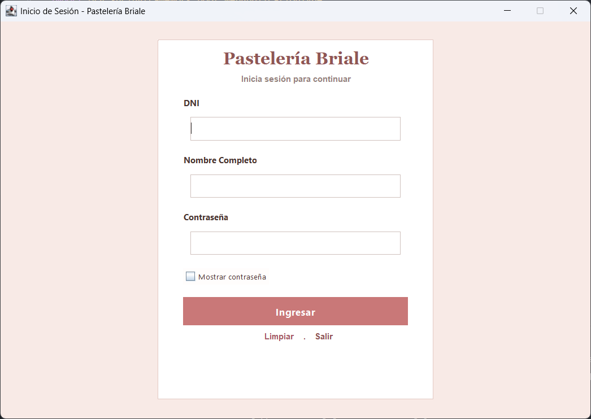
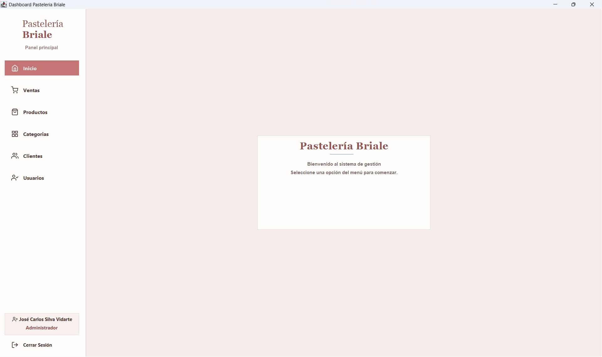
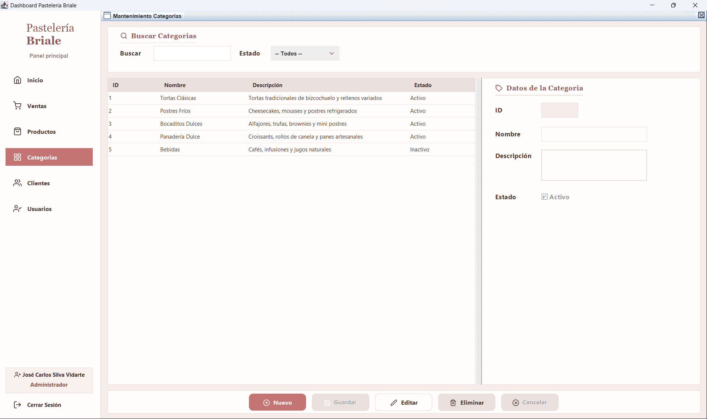
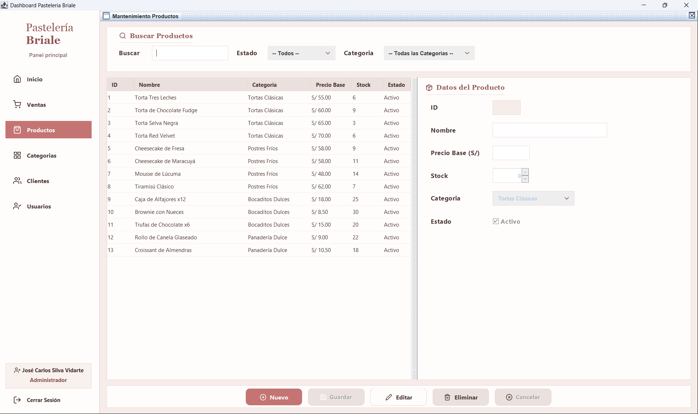
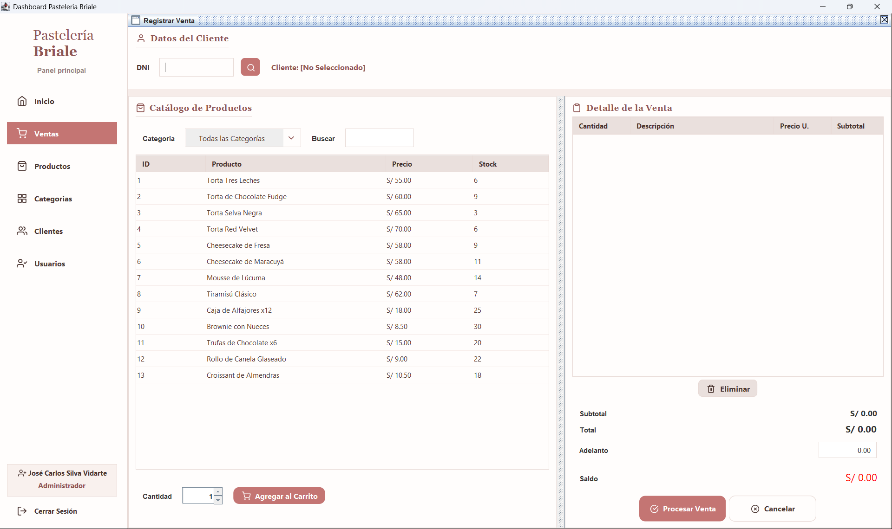

# 🍰 AppPasteleria

Aplicación de escritorio para la gestión de ventas de una pastelería. El sistema permite administrar el catálogo, registrar clientes y empleados, gestionar usuarios y controlar el proceso de ventas desde una interfaz gráfica.

> Proyecto desarrollado con Java, Spring Boot, Spring Data JPA y Microsoft SQL Server.

## ✨ Funcionalidades

- 🔐 Inicio de sesión para el acceso al sistema.
- 📊 Dashboard principal para navegar por los módulos.
- 🧁 Gestión de productos de pastelería.
- 🗂️ Gestión de categorías.
- 👥 Gestión de clientes.
- 👤 Gestión de usuarios y empleados.
- 🛒 Registro de ventas y detalle de cada venta.
- 🔎 Consulta de ventas registradas.
- 🧾 Generación de boletas.
- 🎨 Interfaz de escritorio con estilos e iconos integrados.

## 🧱 Arquitectura del proyecto

El proyecto separa la interfaz, la lógica de negocio y el acceso a datos mediante una estructura por capas:

```text
AppPasteleria/
├── src/
│   ├── main/
│   │   ├── java/com/upn/
│   │   │   ├── enums/          # Enumeraciones del sistema, como roles
│   │   │   ├── frame/          # Ventanas y formularios Swing
│   │   │   ├── model/          # Entidades del dominio
│   │   │   ├── repository/     # Repositorios Spring Data JPA
│   │   │   ├── service/        # Lógica de negocio
│   │   │   └── util/           # Estilos y generación de boletas
│   │   └── resources/
│   │       └── application.properties
│   └── test/                   # Pruebas de la aplicación
├── pom.xml                    # Dependencias y configuración Maven
├── docs/screenshots/          # Capturas de la aplicación
└── nbactions.xml              # Configuración de ejecución de NetBeans
```

### Entidades principales

- `Persona`: información común de las personas del sistema.
- `Cliente`: datos de los clientes.
- `Empleado`: información de empleados y usuarios.
- `ProductoPasteleria`: productos disponibles para la venta.
- `Categoria`: clasificación de productos.
- `Venta`: cabecera de una venta.
- `DetalleVenta`: productos incluidos en cada venta.

## 🛠️ Tecnologías utilizadas

| Tecnología | Uso |
| --- | --- |
| Java 25 | Lenguaje principal |
| Spring Boot 3.5.4 | Inicialización y configuración de la aplicación |
| Spring Data JPA | Persistencia y acceso a datos |
| Hibernate | Mapeo objeto-relacional |
| Microsoft SQL Server | Base de datos |
| Maven | Gestión del proyecto y dependencias |
| Java Swing | Interfaz gráfica de escritorio |
| JCalendar | Componentes para selección de fechas |
| Ikonli | Iconos para la interfaz |

## ✅ Requisitos previos

Antes de ejecutar el proyecto, instala y configura:

- JDK 25.
- Maven 3.9 o superior.
- Microsoft SQL Server ejecutándose en `localhost:1433`.
- Una base de datos llamada `PasteleriaBrialeBD`.

## ⚙️ Configuración de la base de datos

La conexión se configura en:

```text
src/main/resources/application.properties
```

Ejemplo de configuración:

```properties
spring.datasource.url=jdbc:sqlserver://localhost:1433;databaseName=PasteleriaBrialeBD;encrypt=true;trustServerCertificate=true;
spring.datasource.username=TU_USUARIO
spring.datasource.password=TU_CONTRASEÑA
spring.datasource.driver-class-name=com.microsoft.sqlserver.jdbc.SQLServerDriver
```

La aplicación utiliza `spring.jpa.hibernate.ddl-auto=update`, por lo que Hibernate puede actualizar las tablas a partir de las entidades al iniciar. Verifica las credenciales y permisos del usuario de SQL Server antes de ejecutar el sistema.

## 🚀 Instalación y ejecución

1. Clona el repositorio:

   ```bash
   git clone https://github.com/CarloosssDev/AppPasteleria.git
   cd AppPasteleria
   ```

2. Configura la conexión a SQL Server en `application.properties`.

3. Compila el proyecto:

   ```bash
   mvn clean package
   ```

4. Ejecuta la aplicación de escritorio:

   ```bash
   mvn spring-boot:run
   ```

También puedes abrir el proyecto desde NetBeans como proyecto Maven y ejecutar la clase principal:

```text
src/main/java/com/upn/AppPasteleriaApplication.java
```

Al iniciar, Spring Boot crea el contexto de la aplicación y muestra la ventana de inicio de sesión.

## 🧪 Pruebas

Para ejecutar las pruebas disponibles:

```bash
mvn test
```

## 🖼️ Capturas de pantalla

Las capturas de la aplicación se encuentran en [`docs/screenshots/`](docs/screenshots/):

### Inicio de sesión



### Dashboard



### Gestión de categorías



### Gestión de productos



### Registro de ventas



## 📌 Notas de desarrollo

- Las ventanas de la interfaz se encuentran en `com.upn.frame` y cada formulario Swing tiene su archivo `.form` asociado.
- La aplicación se ejecuta en modo no web (`WebApplicationType.NONE`) porque está diseñada como cliente de escritorio.
- Los repositorios y servicios siguen el flujo `frame → service → repository → SQL Server`.
- Evita subir credenciales reales al repositorio; utiliza valores locales para la conexión a la base de datos.

## 📄 Licencia

Este proyecto está bajo la licencia [MIT](LICENSE).
